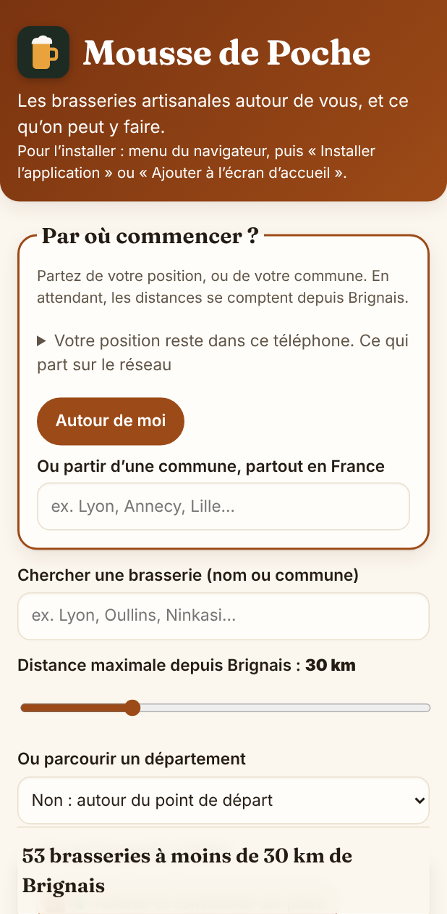
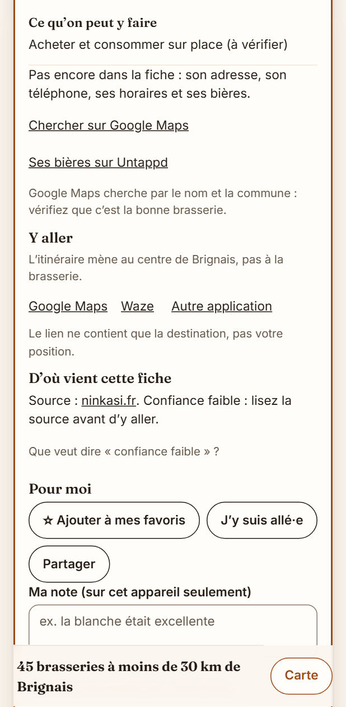
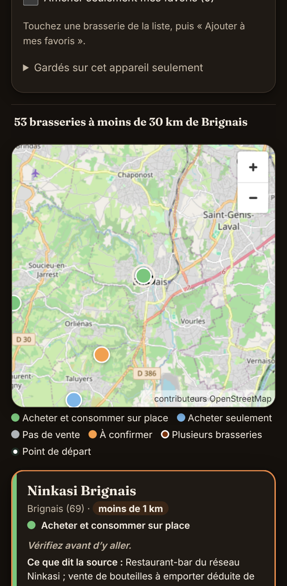

# Mousse de Poche

Les brasseries artisanales autour de vous, et ce qu'on peut y faire :
acheter et boire sur place, acheter seulement, rien de tout ça, ou « à
confirmer » quand aucune source ne l'établit.

**Ouvrir l'application : <https://opaland.github.io/Brewery-map/>**
— sur téléphone, elle s'installe comme une application et reste
consultable hors connexion.

<p>
  
</p>

## Ce qu'elle fait

- **Toute la France** : 549 fiches vérifiées dans 47 départements (01, 03, 04, 05,
  06, 07, 13, 14, 15, 18, 21, 22, 25, 26, 27, 28, 29, 2A, 2B, 35, 36, 37, 38, 39, 41, 42, 43,
  44, 45, 49, 50, 53, 56, 58, 61, 63, 69, 70, 71, 72, 73, 74, 76, 83, 84, 85, 89), et 783 brasseries repérées sur OpenStreetMap
  ailleurs,
  affichées « À confirmer », sur une liste et une carte.
- **Partir de n'importe où** : « Autour de moi », ou une commune tapée parmi
  les 34 968 communes de France ; les distances se comptent depuis là.
- **Filtrer** par distance, par ce qu'on peut y faire, par type de bière ;
  chercher une brasserie par son nom, à toute distance.
- **Une fiche par brasserie** : ce que dit la source et avec quelle
  confiance, l'adresse, « Y aller » (Google Maps, Waze, Plans d'Apple, autre
  application), et ce qui n'est pas connu, dit tel quel.
- **Favoris**, gardés sur l'appareil.
- **Signaler une erreur**, par une issue GitHub préremplie.

Rien n'est inventé : sans source, une fiche dit « À confirmer » et pourquoi.
Depuis le 18/10, par la règle de Cédric (`docs/DECISIONS.md`) : 44 des 166
fiches d'origine ont été complétées d'après leur propre site (19
téléphones, 10 horaires, 17 listes de bières, 14 positions à l'adresse) ;
256 sont aujourd'hui placées au centre de leur commune selon l'IGN, faute
d'adresse vérifiée ; 36 brasseries de Normandie, 81 de Bretagne et 75 des Pays de la Loire et
d'Indre-et-Loire sont ajoutées, puis 22 du Centre-Val de Loire et de
Bretagne (S327, S328), 37 de l'Allier, du Cantal, du Puy-de-Dôme et de la
Haute-Savoie (S341), et 46 de Bourgogne-Franche-Comté (S342). Les
propositions et leurs accords sont dans `curation/`.

## Ce qui reste dans le téléphone

Application 100 % côté client : pas de serveur, pas de compte, pas de
télémétrie. La position sert à calculer les distances dans le navigateur, et
ce site ne l'envoie à personne. Ce qui part sur le réseau : les images de la
carte (OpenStreetMap voit la zone affichée), et la liste des communes de la
région du point de départ (de toute la France avec « Autour de moi »),
demandée à ce site (GitHub Pages, qui voit l'adresse IP comme tout site). Le détail est dans
l'application, sous « Votre position reste dans ce téléphone ».

## Captures

| Téléphone | Fiche | Carte, thème sombre |
| --- | --- | --- |
|  |  |  |

Les captures sont refaites par `npx tsx outils/captures.ts` (voir l'en-tête
du fichier).

## Sources et licences

- **Code** : licence MIT (`LICENSE`).
- **Brasseries** (`data/breweries.json`) : fichier fourni par Cédric le
  15/10/2026 ; chaque fiche cite sa source. Licence de réutilisation :
  **ODbL 1.0** (`data/LICENCE.md`), comme la couche OpenStreetMap.
- **Communes** : Code officiel géographique de l'INSEE, via le paquet
  `@etalab/decoupage-administratif` 6.0.0 (données sous Licence Ouverte
  d'Etalab) ; leur point tiré de Wikidata (CC0). Fabriqué par
  `outils/communes.ts`.
- **Brasseries hors des fiches vérifiées** (`src/donnees-osm/brasseries-osm.json`) :
  © contributeurs OpenStreetMap, licence ODbL, extraites par
  `outils/osm-france.ts` (`craft=brewery`). Seul le fait d'être repérée comme
  brasserie vient d'OSM : rien d'autre n'est vérifié.
- **Fond de carte** : © contributeurs
  [OpenStreetMap](https://www.openstreetmap.org/copyright) (ODbL), servi
  par les tuiles d'OpenStreetMap ; rendu par MapLibre GL JS (BSD-3).

## Développer

Node 22 (`.nvmrc`). Il faut un clone complet, pas `--depth 1` : la garde de
`data/` relit l'historique jusqu'au fichier du 15/10.

```bash
# bash ; sous PowerShell, voir plus bas
npm ci
npm run lint && npx tsc -b --noEmit && npx vitest run
npm run build                    # les e2e servent dist/ : rebuild d'abord
npx playwright install chromium
npx playwright test
```

Sans téléchargement de navigateur (conteneur de développement), poser
`PW_CHROMIUM_PATH` vers un Chromium déjà installé ; ailleurs, inutile :
`npx playwright install chromium` suffit. Pour proposer une
correction, ou signaler une erreur de fiche : [`CONTRIBUTING.md`](CONTRIBUTING.md).

`npm run porte` lance toute la porte, dans l'ordre, sous Linux, macOS et
Windows ; le crochet avant commit de Claude Code lance la même.

### Sous Windows (PowerShell)

PowerShell 5.1 refuse `VAR=valeur commande` et `&&` : un pas par ligne, ou
`;`. Cloner sans conversion des fins de ligne : le dépôt est en LF, et les
empreintes de `data/` et des lots en dépendent (`.gitattributes` l'impose
aussi).

```powershell
git clone -c core.autocrlf=false https://github.com/Opaland/Brewery-map.git
cd Brewery-map
npm ci
npx playwright install chromium
npm run porte                    # lint, tsc -b, vitest, garde de data/, build, e2e
```

Une variable d'environnement se pose avant la commande, sur sa ligne :

```powershell
$env:MOUSSE_URL = "https://opaland.github.io/Brewery-map/"
npx playwright test tests/e2e/page-deployee.spec.ts
Remove-Item Env:MOUSSE_URL
```

`PW_CHROMIUM_PATH` est inutile sous Windows : il ne sert que dans le
conteneur cloud, où Chromium est déjà installé.

Le build échoue si `data/breweries.json` ne respecte pas le schéma
(`src/core/schema.ts`). Les règles du projet sont dans [`AGENTS.md`](AGENTS.md), le
plan et le bilan de chaque sprint dans [`docs/SPRINTS.md`](docs/SPRINTS.md),
les données dans [`docs/DONNEES.md`](docs/DONNEES.md), ce qui reste dans
[`BACKLOG.md`](BACKLOG.md).

L'abus d'alcool est dangereux pour la santé, à consommer avec modération.
